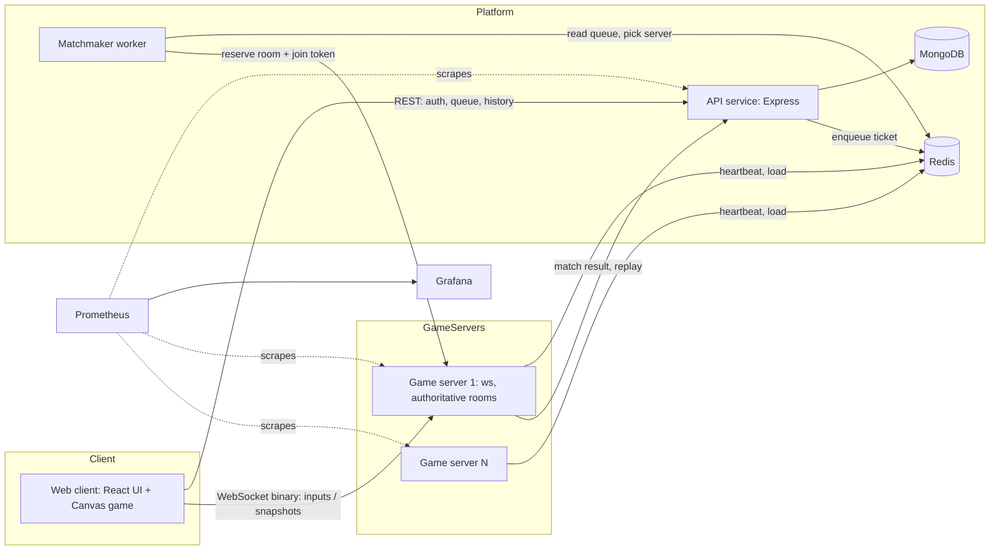

# NetArena: an authoritative multiplayer game server and netcode platform

> **Working title.** A small 2D arena game used as a test bench for production-style real-time networking: authoritative server, client-side prediction, lag compensation, delta-compressed binary snapshots, matchmaking, leaderboards, replays, load testing, observability and deployment.
>
> **The game is deliberately tiny. The networking and infrastructure are the product.**

---

## Table of contents

0. [How to use this document (read first, AI agents)](#0-how-to-use-this-document-read-first-ai-agents)
1. [Project summary, goals and non-goals](#1-project-summary-goals-and-non-goals)
2. [Context about the human developer](#2-context-about-the-human-developer)
3. [Success criteria and measurement rules](#3-success-criteria-and-measurement-rules)
4. [Complete technology list and tech stack](#4-complete-technology-list-and-tech-stack)
5. [Architecture](#5-architecture)
6. [Game specification (defaults)](#6-game-specification-defaults)
7. [Netcode specification](#7-netcode-specification)
8. [Network protocol (draft)](#8-network-protocol-draft)
9. [Data models, Redis keys and REST API](#9-data-models-redis-keys-and-rest-api)
10. [Repository layout, scripts and environment](#10-repository-layout-scripts-and-environment)
11. [Phases](#11-phases)
12. [Test strategy](#12-test-strategy)
13. [Benchmark methodology](#13-benchmark-methodology)
14. [Security and robustness checklist](#14-security-and-robustness-checklist)
15. [Optional stretch goals](#15-optional-stretch-goals)
16. [Risks and mitigations](#16-risks-and-mitigations)
17. [Portfolio packaging and resume bullets](#17-portfolio-packaging-and-resume-bullets)
18. [Glossary and reading list](#18-glossary-and-reading-list)

---

## 0. How to use this document (read first, AI agents)

You are an AI agent helping a human build this project. Follow these rules.

**Process rules**
1. Read this whole document before writing any code.
2. Work **one phase at a time**, in order (Section 11). Do not start a phase until the previous phase's acceptance criteria pass. At the end of each phase, summarize what was built and what was measured, then wait for the human to say "next phase."
3. The human is **learning while building**. For each non-trivial concept (prediction, reconciliation, interpolation, lag compensation, delta compression), explain it in 5-10 plain sentences *before* implementing it, then implement it in small steps. Prefer clear code over clever code.
4. Make **small commits** using Conventional Commits (`feat:`, `fix:`, `test:`, `docs:`, `chore:`, `perf:`). Never commit secrets.
5. Write **tests alongside code**. A task is not done until its tests pass and its acceptance criteria are demonstrated.
6. Keep a **dev log**: append an entry to `docs/devlog.md` at the end of every working session (what was done, what broke, what was learned, what is next).
7. Record every significant design decision as a short ADR in `docs/adr/NNNN-title.md` (context, decision, alternatives, consequences).

**Honesty and accuracy rules**
- **Never fabricate benchmark numbers or claims.** Every number in docs or resume bullets must come from a measurement recorded under `docs/benchmarks/` with the method in Section 13. If something has not been measured, write "not yet measured."
- **Verify library APIs against current official documentation** before using them. Library versions and APIs change; do not rely on memory. Install the current stable version with the package manager and let the lockfile pin it. Do not invent URLs.
- If a requirement in this document conflicts with reality (a library no longer works, a tool changed), stop, explain the conflict, propose an alternative, and record an ADR.
- If you are unsure about a requirement, ask the human **one clear question** and propose a default.

**Constraints**
- Everything must run on the human's **Linux laptop**, with **no GPU** and **no paid or third-party GPU/compute-renting services**. The only external service planned is AWS, used for hosting at the end (Phase 7). Check current AWS free-tier terms and set a billing alarm before creating any AWS resource.
- Use **TypeScript** everywhere except where a phase says otherwise.
- Keep the game itself minimal. If a task adds gameplay content (new weapons, maps, art) without serving a networking goal, do not do it.

**Open decisions (defaults apply unless the human overrides)**

| Decision | Default | Alternative |
|---|---|---|
| Package manager | pnpm workspaces | npm workspaces |
| Database | MongoDB | PostgreSQL |
| Game rendering | Plain Canvas 2D | Phaser (rendering only; simulation stays separate) |
| Binary encoding | Hand-written `DataView` codec | MessagePack/protobuf (benchmark only, Section 15) |

---

## 1. Project summary, goals and non-goals

### Summary
NetArena is a browser-based 2D top-down arena shooter for 2-8 players per room. Players move, aim and fire a hitscan weapon. The server is **authoritative**: clients send inputs, never positions. The client hides latency with prediction and interpolation. The server rewinds time for fair hit detection. Snapshots are binary and delta-compressed. Around the game sits a platform: accounts, matchmaking, multiple game-server processes, leaderboards, match history, deterministic replays, metrics, a bot-based load tester and a deployment pipeline.

### What "engineering marvel" means here
The project is not about a large game. It is about implementing, in a documented and **measured** way, the networking ideas behind classic multiplayer shooters: an authoritative server (Quake), client-side prediction (QuakeWorld) and lag compensation (Valve's Source engine), and then operating the result like a real service.

### Goals
- A playable 2-8 player arena that feels responsive at 100-150 ms round-trip latency and under 5% packet loss.
- A shared, deterministic TypeScript simulation used by both client and server.
- A binary protocol with delta snapshots and interest management, with measured bandwidth savings.
- A bot-driven load test that finds the saturation point of one game-server process.
- A multi-service platform (API, matchmaker, game servers, Redis, MongoDB) running via Docker, deployed to AWS.
- A written design document and a demo video comparing "with" and "without" each netcode technique.

### Non-goals
- No art pipeline, sound, game content beyond one weapon and one map layout.
- No monetization, payments or ads.
- No training of machine-learning models. (Bots use simple scripted behavior.)
- No custom UDP transport in the core scope (browsers cannot use raw UDP). WebTransport/WebRTC is an optional stretch.

---

## 2. Context about the human developer

- A fresher developer targeting full-stack/backend roles, building a portfolio project to show real-time systems skills.
- Comfortable with the basics of JavaScript/TypeScript, React, Node.js and Express; a **beginner at game networking**.
- Wants to showcase: TypeScript, React, Express, MongoDB, Docker, AWS and Kubernetes (Kubernetes only where it genuinely fits; see Phase 7).
- Develops on Linux (Linux Mint). `tc netem` and Docker are available.
- Hardware is a mid-range laptop with a weak GPU. Do not require GPU work.
- Learns best with explanations before code, small steps and visible results each phase.

---

## 3. Success criteria and measurement rules

### Functional success
- [ ] Two to eight humans (and bots) can play a full match in the browser.
- [ ] With simulated 150 ms RTT and 5% packet loss, the local player's movement feels immediate (prediction) and other players move smoothly (interpolation).
- [ ] Shots that look like hits on the shooter's screen register as hits (lag compensation), within a documented rewind limit.
- [ ] Users can register, log in, queue for a match, play, and see results in match history and on a leaderboard.
- [ ] A recorded match can be replayed from its input log and reaches the identical final state hash.
- [ ] The whole system starts with one command (`docker compose up`) and is deployed to AWS over HTTPS/WSS.

### Quantified targets (hypotheses, to be set by measurement)
These are **budgets and hypotheses, not promises.** Record the real values in `docs/benchmarks/`.

| Metric | Initial budget/hypothesis | How measured |
|---|---|---|
| Simulation tick rate | 60 Hz (dt = 1/60 s) | config constant |
| Snapshot rate | 20 Hz (every 3rd tick) | config constant |
| Server tick compute time, p99 | ≤ 25% of tick interval (about 4 ms at 60 Hz) | histogram metric |
| Packet size | ≤ 1,200 bytes per snapshot message | protocol tests |
| Bandwidth per client (8-player room) | JSON baseline vs binary vs delta: report all three | bot test |
| Max rooms per game-server process | unknown; **find it** | load test saturation sweep |
| Prediction error after reconciliation | below a visible threshold (suggest 1 unit) at 150 ms RTT | automated test |
| Lag-compensation rewind cap | 250 ms (configurable) | config constant |

---

## 4. Complete technology list and tech stack

### 4.1 Languages and runtime
| Item | Use |
|---|---|
| TypeScript (strict mode) | all packages |
| Node.js (current LTS) | API, matchmaker, game server, bots, tooling |
| Browser JavaScript APIs | Canvas 2D, WebSocket, `ArrayBuffer`/`DataView`, `performance.now()`, `requestAnimationFrame` |
| Bash | scripts (`tc netem`, benchmarks) |

### 4.2 Monorepo and build tooling
| Tool | Use |
|---|---|
| pnpm workspaces | monorepo package management |
| `tsc` (project references) | type-checking and package builds |
| `tsx` | running TypeScript in development |
| Vite | web client dev server and bundling |
| ESLint + Prettier | linting and formatting |
| Husky + lint-staged (optional) | pre-commit checks |
| Conventional Commits | commit message convention |

### 4.3 Frontend
| Tool | Use |
|---|---|
| React | login, lobby, matchmaking, leaderboard, match history, settings UI |
| Canvas 2D | game rendering (separate from React state) |
| React Router | page routing |
| A small state library (Zustand or React context) | UI state only; **never** put per-tick game state in React state |

### 4.4 Backend services
| Tool | Use |
|---|---|
| Express | REST API (auth, profiles, matchmaking tickets, leaderboards, history, replays) |
| `ws` | WebSocket server for game servers (binary frames) |
| zod | validating REST payloads and config |
| jose or jsonwebtoken | JWT access tokens and room join tokens |
| argon2 (or bcrypt) | password hashing |
| helmet, cors, express-rate-limit | HTTP hardening |
| pino | structured logging |
| ioredis | Redis client |
| MongoDB driver or Mongoose | persistence |
| dotenv | environment configuration |

### 4.5 Data stores
| Store | Use |
|---|---|
| MongoDB | users, matches, replay metadata and replay files (small) |
| Redis | matchmaking queues, game-server registry with heartbeats, room registry, leaderboards (sorted sets), pub/sub |

### 4.6 Observability and testing
| Tool | Use |
|---|---|
| prom-client | metrics endpoint on each Node service |
| Prometheus | metrics collection (docker compose) |
| Grafana | dashboards (docker compose) |
| `perf_hooks.monitorEventLoopDelay` | event-loop lag measurement |
| Vitest | unit and integration tests |
| Supertest | REST API tests |
| Playwright | optional browser end-to-end tests |
| Custom headless bot client | load and soak testing |
| `tc netem` (Linux traffic control) | real network latency, jitter and loss injection |
| In-app simulated link | deterministic latency/loss for tests |

### 4.7 Infrastructure and delivery
| Tool | Use |
|---|---|
| Docker (multi-stage builds) + Docker Compose | local and production-like environments |
| Caddy or Nginx | TLS termination and reverse proxy (WSS) |
| GitHub Actions | CI: lint, type-check, test, build images; optional CD |
| AWS EC2 | primary deployment target |
| AWS ECR (optional) | container image registry |
| AWS CloudWatch billing alarm | cost safety |
| Terraform (optional) | infrastructure as code |
| Kubernetes via kind or k3s (optional stretch) | local cluster experiment; Agones for game-server pods (verify current status before use) |

---

## 5. Architecture



### Services
| Service | Responsibility |
|---|---|
| `web` | UI and game client: input capture, prediction, interpolation, rendering |
| `api` | auth, profiles, matchmaking tickets, leaderboards, match history, replay storage |
| `matchmaker` | consumes queue, groups players, selects a game server, creates a room, issues join tokens (may start as a loop inside `api`, then split out) |
| `game-server` | runs authoritative rooms at fixed tick rate, WebSocket endpoint, lag compensation, snapshots, recording |
| `bots` | headless clients for load tests |
| `shared` (library) | deterministic simulation, constants, protocol codec, types |

### Key design principles
1. **The simulation is a pure, deterministic library** (`packages/shared`). It has no I/O, no `Date.now()`, no `Math.random()` (use a seeded PRNG) and no DOM or Node APIs. Client and server run the same code.
2. **Transport is an interface.** Game logic talks to `Transport`, never to `ws` directly. Implementations: `WebSocketTransport` and `SimulatedLinkTransport` (wraps another transport and adds latency, jitter, loss, duplication and reordering).
3. **Rendering is separate from simulation.** The renderer reads state; it never mutates it.
4. **Server decides everything that matters.** Clients are untrusted.

---

## 6. Game specification (defaults)

All values live in `packages/shared/src/config.ts` and are tunable. Units are world units (wu) and seconds.

| Property | Default |
|---|---|
| Arena (gameplay profile) | 1200 × 800 wu, bounded by walls |
| Arena (stress profile, for load tests and interest management) | 6000 × 6000 wu |
| Obstacles | 6-10 static axis-aligned rectangles (fixed layout from a seed) |
| Players per room | 2-8 (stress tests: up to 100 bots) |
| Player shape and radius | circle, 16 wu |
| Movement | direct velocity from input; max speed 220 wu/s; diagonal normalized |
| Collision | circle vs circle (players), circle vs AABB (obstacles, walls) |
| Aim | angle quantized to 16 bits over 0-2π |
| Weapon | **hitscan** ray, range 700 wu, cooldown 0.4 s, damage 25 |
| Health | 100; respawn after 3 s at a spawn point with 1.5 s of invulnerability |
| Match end | first to 20 kills or 5 minutes |
| Tick rate | 60 Hz simulation; 20 Hz snapshots |

**Why hitscan:** it is the classic case for lag compensation, which is one of the central techniques of this project. A visible tracer shows each shot.

**Determinism rules for the simulation**
- Fixed timestep; never use variable `dt` in the simulation.
- Seeded PRNG (for example mulberry32) for any randomness, seeded per match.
- Avoid transcendental functions (`Math.sin`, `Math.cos`, `Math.atan2`) inside the simulation. Their results can differ across JavaScript engines. Use a precomputed sine/cosine lookup table keyed by the quantized angle. Basic arithmetic (`+ - * /`) is deterministic under IEEE-754; verify `Math.sqrt` with the determinism test.
- Iterate entities in a stable order (sorted by id).
- Provide `hashState(state): number` for determinism tests and replay verification.

---

## 7. Netcode specification

### 7.1 Time and loops
- **Server loop:** accumulator-based fixed timestep using `process.hrtime.bigint()`. Each tick: apply queued inputs, step simulation, record history, and (every 3rd tick) build and send snapshots. Measure tick duration and overruns. Never block the event loop.
- **Client loop:** `requestAnimationFrame` for rendering; a fixed-timestep accumulator for prediction at the same 60 Hz.
- Enable TCP no-delay on sockets; keep `permessage-deflate` disabled for game traffic.

### 7.2 Client input and prediction
- Each client tick creates an `InputCmd { seq, moveX, moveY, aim, fire }`. Apply it locally immediately (prediction) and store it in a ring buffer of unacknowledged inputs.
- Send inputs to the server every client tick, bundling the last N unacknowledged inputs for redundancy against packet loss (start with N = 3).
- The server processes inputs in `seq` order, ignores duplicates and old inputs, and enforces limits (inputs per tick, plausible rates).

### 7.3 Reconciliation
- Every snapshot includes `lastProcessedInputSeq` for that client and the authoritative state of the client's entity.
- On snapshot: set local state to the authoritative state, discard acknowledged inputs, **re-apply** all still-unacknowledged inputs through the shared simulation, and compare with the previously predicted state.
- Smooth small corrections (blend the visual position toward the corrected position over a short time); snap on large errors (above a threshold such as 50 wu).

### 7.4 Entity interpolation (remote players)
- Render other players at `renderTime = serverTimeEstimate − interpDelay`, where `interpDelay` defaults to 100 ms (about two snapshot intervals).
- Keep a buffer of recent snapshots per entity; interpolate between the two snapshots surrounding `renderTime`. If the buffer runs dry, extrapolate for at most about 100 ms, then hold position.

### 7.5 Clock synchronization
- Client sends `PING` with its timestamp; server replies with `PONG` containing the echoed time and the server tick. Use the minimum-RTT samples over a sliding window to estimate offset and RTT.
- Maintain a smoothed `serverTimeEstimate`.

### 7.6 Lag compensation
- The server stores a history ring buffer of player positions for the last 1 second of ticks.
- A `fire` input carries the client's `renderTick` (the tick of the interpolated world the shooter was looking at).
- The server computes `rewindTicks`, clamps it to the maximum (default 250 ms), rewinds all **other** players to that tick, performs the ray test, and then applies damage in the present. It never rewinds the shooter or changes history.
- Reject or clamp rewinds above the cap. Make lag compensation **toggleable** by config to allow side-by-side demos and tests.

### 7.7 Snapshots and delta compression
- Each snapshot contains: server tick, `lastProcessedInputSeq` for the recipient, and entity states.
- The client periodically acknowledges the latest snapshot tick it received. The server keeps the last few snapshots per client and encodes the **delta against the last acknowledged snapshot** (changed fields only). If no valid baseline exists or the baseline is too old, send a full snapshot.
- Quantize values: positions to 1/16 wu in 16-bit fields (relative to the arena), angles to 16 bits, health to 8 bits.
- Interest management: only include entities within a view radius (stress profile), using a uniform grid for neighbor queries.

### 7.8 Reconnection and disconnect handling
- Heartbeat/timeout detection (for example 5 seconds without input).
- A dropped player's entity stays for a grace period (30 seconds), during which the same join token can rejoin and receive a full snapshot.

---

## 8. Network protocol (draft)

Binary frames over WebSocket (`binaryType = "arraybuffer"`). Little-endian. First byte is the message type. Document the final protocol in `docs/protocol.md` and keep a `PROTOCOL_VERSION` constant that is checked in `HELLO`.

### Client → server
| Type | Name | Payload |
|---|---|---|
| 0x01 | `HELLO` | protocolVersion u16, joinToken (length-prefixed string) |
| 0x02 | `INPUT` | count u8, then per input: seq u32, moveX i8, moveY i8, aim u16, flags u8 (bit0 fire), renderTick u32 |
| 0x03 | `SNAPSHOT_ACK` | serverTick u32 |
| 0x04 | `PING` | clientTime f64 |
| 0x05 | `LEAVE` | none |

### Server → client
| Type | Name | Payload |
|---|---|---|
| 0x81 | `WELCOME` | playerId u16, roomId (string), tickRate u8, snapshotRate u8, world config id, serverTick u32 |
| 0x82 | `SNAPSHOT_FULL` | serverTick u32, lastProcessedSeq u32, entityCount u16, entities |
| 0x83 | `SNAPSHOT_DELTA` | serverTick u32, baselineTick u32, lastProcessedSeq u32, change mask + changed entities, removed ids |
| 0x84 | `EVENT` | kind u8 (hit, kill, respawn, matchEnd), data |
| 0x85 | `PONG` | echoedClientTime f64, serverTick u32 |
| 0x86 | `ERROR` | code u8, message string |

Phase 1 may use JSON for readability; Phase 4 replaces it with the binary format above and records the before/after comparison. The codec must live in `packages/shared` with round-trip and fuzz tests.

---

## 9. Data models, Redis keys and REST API

### 9.1 MongoDB collections
```
users:    { _id, username (unique), passwordHash, createdAt, rating, stats: { kills, deaths, matches } }
matches:  { _id, roomId, serverId, mode, startedAt, endedAt, seed, configVersion,
            players: [{ userId, name, kills, deaths }], winnerUserId?, replayId? }
replays:  { _id, matchId, formatVersion, seed, config, joinLeaveEvents, inputsBlob (Buffer),
            checkpointHashes: [{ tick, hash }], sizeBytes, createdAt }
```
Indexes: `users.username` unique; `matches.players.userId` + `endedAt` descending; `replays.matchId`.

### 9.2 Redis keys
| Key | Type | Purpose |
|---|---|---|
| `mm:queue:{mode}` | sorted set | waiting tickets (score = enqueue time or rating) |
| `mm:ticket:{id}` | hash | ticket state (`queued`, `matched`, `cancelled`), room and token |
| `gs:{serverId}` | hash with TTL | game-server heartbeat (host, port, rooms, players, load) |
| `room:{roomId}` | hash | room info (server, players, state) |
| `lb:global` | sorted set | leaderboard (score = rating or kills) |
| pub/sub `events:rooms` | channel | room and match lifecycle events |

### 9.3 REST API (Express)
| Method and path | Purpose |
|---|---|
| `POST /auth/register` | create account |
| `POST /auth/login` | returns access token |
| `GET /me` | current user and stats |
| `POST /matchmaking/tickets` | enter queue (body: mode) |
| `GET /matchmaking/tickets/:id` | poll status; when matched returns `{ serverUrl, roomId, joinToken }` |
| `DELETE /matchmaking/tickets/:id` | leave queue |
| `GET /leaderboard?limit=` | top players |
| `GET /matches?userId=&limit=` | match history |
| `GET /matches/:id` | match detail |
| `GET /replays/:matchId` | download replay |
| `GET /health` | liveness and readiness |
| `GET /metrics` | Prometheus metrics |

Join tokens are short-lived JWTs scoped to a room and a user. Game servers verify the token on `HELLO`.

---

## 10. Repository layout, scripts and environment

```
netarena/
  apps/
    web/             React + Vite client, Canvas game renderer
    api/             Express REST API
    matchmaker/      matchmaking worker (may begin inside api)
    game-server/     authoritative WebSocket game server
    bots/            headless bot client and load-test runner
  packages/
    shared/          deterministic simulation, config, protocol codec, types, PRNG, hash
    transport/       Transport interface, WebSocketTransport, SimulatedLinkTransport
    eslint-config/   shared lint config (optional)
  infra/
    docker/          Dockerfiles, compose files, Caddy/Nginx config
    prometheus/      prometheus.yml
    grafana/         dashboard JSON
    netem/           scripts: add/remove latency, jitter, loss presets
    k8s/             optional manifests (stretch)
    terraform/       optional IaC
  docs/
    devlog.md
    design.md        final netcode design document
    protocol.md
    adr/             architecture decision records
    benchmarks/      raw data (CSV/JSON) + benchmarks.md summary
  .github/workflows/ ci.yml (and optional cd.yml)
  README.md
```

### Suggested root scripts
```
pnpm dev                 # run web, api, game-server, redis, mongo (compose for datastores)
pnpm build               # build all packages
pnpm test                # run all tests
pnpm lint / pnpm typecheck
pnpm bots -- --rooms 4 --bots-per-room 8 --latency 100 --loss 0.02
pnpm bench               # run the benchmark matrix and write CSV to docs/benchmarks/
docker compose up        # full stack including Prometheus and Grafana
```

### Environment variables (`.env.example`)
```
NODE_ENV=development
API_PORT=3000
GAME_SERVER_PORT=8080
GAME_SERVER_ID=gs-1
GAME_SERVER_PUBLIC_URL=ws://localhost:8080
MONGO_URL=mongodb://localhost:27017/netarena
REDIS_URL=redis://localhost:6379
JWT_SECRET=change-me
JOIN_TOKEN_SECRET=change-me
TICK_RATE=60
SNAPSHOT_RATE=20
LAG_COMP_ENABLED=true
LAG_COMP_MAX_MS=250
INTERP_DELAY_MS=100
```
Local ports: web 5173, API 3000, game server 8080, MongoDB 27017, Redis 6379, Prometheus 9090, Grafana 3001.

---

## 11. Phases

Time estimates are rough (part-time). Total about **10-14 weeks**. Each phase lists goal, concepts to learn, tasks, deliverables and acceptance criteria. Mark tasks as done by checking the boxes.

### Phase 0: Foundations and deterministic simulation (1-2 weeks)
**Goal:** a clean monorepo and a single-player game running on the shared deterministic simulation.

**Concepts to learn:** fixed timestep and accumulator loops; determinism; seeded PRNG; separating simulation from rendering.

**Tasks**
- [ ] Create the pnpm monorepo with the layout in Section 10; strict TypeScript, ESLint, Prettier, Vitest, Conventional Commits.
- [ ] `packages/shared`: config, math helpers (vector ops), seeded PRNG, sine/cosine lookup table, entity types, `createInitialState(seed, config)`, `step(state, inputsByPlayer, dt)`, `hashState(state)`.
- [ ] Implement movement, circle/AABB collision, spawn points, health, hitscan ray test, respawn and scoring in `step`.
- [ ] `apps/web`: Vite + React shell; Canvas renderer reading state; keyboard/mouse input mapping to `InputCmd`; fixed-timestep client loop.
- [ ] Debug overlay (FPS, tick, entity count).
- [ ] Unit tests: collision cases, ray test, health/respawn rules, **determinism test** (same seed and input list produces the same `hashState` at tick N, run twice).

**Deliverables:** playable single-player sandbox with a dummy target; passing tests; `docs/devlog.md` started; ADR for package manager and rendering choice.

**Acceptance criteria:** determinism test passes; `step` has no I/O or time/random calls (enforce with a lint rule or test); the game runs at a steady 60 Hz simulation in the browser.

### Phase 1: Authoritative server with naive networking (1 week)
**Goal:** two browsers play together through an authoritative server, and you can feel the lag.

**Concepts:** client-server model; authoritative state; why naive rendering of the latest snapshot feels bad.

**Tasks**
- [ ] `packages/transport`: `Transport` interface; `WebSocketTransport`; **`SimulatedLinkTransport`** (configurable one-way latency, jitter, loss, duplication, reordering; deterministic option using a seeded PRNG).
- [ ] `apps/game-server`: `ws` server; room manager; join by room id (token check can be stubbed for now); accumulator tick loop; per-room simulation using `packages/shared`.
- [ ] Protocol v0 in JSON: `INPUT` and full `SNAPSHOT` (readable for debugging).
- [ ] Client sends inputs, renders **only** the latest received snapshot (no prediction yet).
- [ ] Server metrics logging: tick duration, overruns, connected players.
- [ ] Tests: server integration test with two scripted clients; transport unit tests (latency applied, loss rate within tolerance).

**Deliverables:** playable multiplayer with a latency/loss slider in the debug UI; ADR on transport abstraction.

**Acceptance criteria:** two tabs play together; at 150 ms simulated latency the local player's movement visibly lags (documented in the devlog with a short note or GIF); the server holds 60 Hz without tick overruns for a 2-player room.

### Phase 2: Prediction, reconciliation, interpolation (1.5-2 weeks), the core
**Goal:** local movement feels instant at high latency; remote players look smooth.

**Concepts:** client-side prediction; server reconciliation; entity interpolation; clock sync.

**Tasks**
- [ ] Add `seq` to inputs; maintain the unacknowledged-input ring buffer on the client.
- [ ] Server returns `lastProcessedInputSeq` per client in snapshots; process inputs in order and ignore duplicates.
- [ ] Client reconciliation by re-simulating pending inputs on top of authoritative state; smoothing for small errors, snap for large.
- [ ] Input redundancy (bundle the last N inputs per message).
- [ ] Clock sync via `PING`/`PONG`; `serverTimeEstimate`.
- [ ] Remote-player interpolation with a snapshot buffer; limited extrapolation.
- [ ] Debug UI: toggles for prediction, reconciliation and interpolation; overlay showing the server "ghost" position, current prediction error and RTT estimate.
- [ ] Automated test (headless, simulated link: 150 ms RTT, 5% loss): after reconciliation the predicted position stays within the error threshold of the server position during scripted movement.

**Deliverables:** a side-by-side comparison with each technique toggled; ADR documenting the smoothing/snap thresholds.

**Acceptance criteria:** with prediction on, local input response is immediate at 150 ms RTT; with interpolation on, remote movement is visibly smooth at 20 Hz snapshots; the automated test passes; graphs/notes of prediction error with and without redundancy under loss are recorded.

### Phase 3: Hit detection and lag compensation (1 week)
**Goal:** shots that hit on the shooter's screen count as hits.

**Concepts:** why high-latency players miss moving targets; server-side rewind; fairness trade-offs ("shot around the corner").

**Tasks**
- [ ] History ring buffer of positions per tick on the server (1 s).
- [ ] `fire` carries `renderTick`; compute and clamp the rewind; rewind others, ray test, apply damage in the present.
- [ ] Hit/kill events sent to clients; client shows tracer, hit marker and damage feedback; handle misprediction of kills gracefully (no false confirmation: wait for the server event).
- [ ] Config flag `LAG_COMP_ENABLED`; metrics for rewind amount.
- [ ] Tests: scripted scenario with a moving target and 150 ms latency, hit with lag compensation on, miss with it off; rewind clamp test.

**Deliverables:** a recorded A/B demo; ADR on rewind cap and fairness.

**Acceptance criteria:** the scripted scenario consistently produces the expected hit/miss results; rewinds never exceed the cap; no history mutation (tests verify the present state is unchanged by the rewind query).

### Phase 4: Bandwidth: binary protocol, delta snapshots, interest management (1-1.5 weeks)
**Goal:** replace JSON with a compact binary protocol and measure the savings.

**Concepts:** quantization; delta compression against an acknowledged baseline; packet budgets; interest management.

**Tasks**
- [ ] Binary codec in `packages/shared` (`BinaryWriter`/`BinaryReader` over `DataView`) following Section 8; protocol version check in `HELLO`.
- [ ] Quantization of positions, angles and health.
- [ ] `SNAPSHOT_ACK`; per-client snapshot history; delta encoding with change masks; fallback to full snapshots when the baseline is missing or too old.
- [ ] Interest management with a uniform grid for the stress profile (view radius default 800 wu).
- [ ] Codec round-trip tests and fuzz tests (random states, truncated or corrupted buffers must not crash the server).
- [ ] Benchmark: bytes/s per client for **JSON vs binary full vs binary delta vs delta + interest management** at 8 players and at 64 bots (stress profile).
- [ ] Write `docs/protocol.md`.

**Deliverables:** benchmark table with raw data under `docs/benchmarks/`; protocol document.

**Acceptance criteria:** all snapshots fit the packet budget (≤ 1,200 bytes) in the normal profile; fuzz tests pass; measured savings are reported honestly (including cases where delta does not help).

### Phase 5: Platform services (2 weeks)
**Goal:** accounts, matchmaking, multiple game servers, leaderboards, history and replays.

**Concepts:** service registry with heartbeats; queue-based matchmaking; short-lived scoped tokens; deterministic replays.

**Tasks**
- [ ] `apps/api`: Express + zod + helmet + rate limiting; register/login with argon2 (or bcrypt); JWT access tokens; MongoDB models and indexes; the REST endpoints in Section 9.
- [ ] Matchmaker: queue in Redis, loop that groups N players (mode defaults: 2-8), picks the least-loaded live game server from `gs:*` heartbeats, asks it to create a room (internal authenticated endpoint or Redis command), writes the ticket result with a join token.
- [ ] Game server: registers a heartbeat with TTL; verifies join tokens on `HELLO`; reports match results to the API (or via Redis stream) on match end.
- [ ] Leaderboard: Redis sorted set updated at match end; periodically persisted to MongoDB; simple Elo-style rating (optional).
- [ ] Replay recording: seed, config, join/leave events and per-tick inputs; checkpoint hashes every 60 ticks; compress and store in MongoDB (document the size limit and what to do beyond it).
- [ ] Replay player in the web client (replays by re-running the shared simulation).
- [ ] React UI: login/register, lobby with "find match", queue status, leaderboard, match history, replay list.
- [ ] Support running at least **two game-server processes** locally.
- [ ] Tests: API integration tests with Supertest; matchmaker unit tests; replay verification test.

**Deliverables:** end-to-end flow working locally; ADR on matchmaking design and replay format.

**Acceptance criteria:** two real accounts log in, queue, are matched, play, and see the result in history and on the leaderboard; replay of that match reaches the **identical final state hash** and passes all checkpoint hashes; killing one game-server process removes it from the registry within the TTL and the matchmaker stops assigning to it.

### Phase 6: Bot load tester and observability (1-1.5 weeks)
**Goal:** find out how much one game-server process can carry, and prove it with data.

**Concepts:** load testing methodology; latency percentiles; saturation; event-loop lag; why single-threaded Node bounds a process.

**Tasks**
- [ ] `apps/bots`: headless client reusing `packages/shared` and `packages/transport`; behaviors: random walk, chase nearest, fire periodically; configurable counts, latency and loss; optional authentication via the real API.
- [ ] Metrics (prom-client) on game server and API: tick duration histogram, tick overruns, snapshot bytes sent, messages in/out, connected players, rooms, event-loop lag, process CPU/memory, rewind amounts, snapshot-baseline fallbacks.
- [ ] Docker Compose profile with Prometheus and Grafana; a provisioned Grafana dashboard stored in `infra/grafana/`.
- [ ] `infra/netem/` scripts to add/remove `tc netem` presets (latency 50/100/150/250 ms one-way variants, jitter, loss 0/1/5/10%).
- [ ] Benchmark runner: sweep the number of rooms (and bots per room), measure p50/p95/p99 tick duration, overrun rate, bandwidth and CPU; find the saturation point (first load level where p99 tick duration exceeds the budget or overruns appear).
- [ ] Soak test (for example 30-60 minutes) watching memory growth and tick stability.
- [ ] Failure test: kill a game-server process mid-match and document the behavior.

**Deliverables:** `docs/benchmarks/benchmarks.md` with methodology, hardware/software details, tables and charts; Grafana screenshot; list of identified bottlenecks and one optimization with before/after numbers.

**Acceptance criteria:** reproducible runs (script plus commit hash recorded); saturation point reported with the exact method; at least one measured optimization (for example reducing allocations in the tick loop, reusing buffers, or batching sends).

**Notes on `tc netem`:** applying it on the loopback interface (`lo`) delays traffic in both directions and also affects database and Redis traffic on localhost. Use it for final validation; use `SimulatedLinkTransport` for most tests. Remember to remove the rule afterwards (`sudo tc qdisc del dev lo root`).

### Phase 7: Deployment and scaling (1-2 weeks)
**Goal:** the system runs on AWS behind HTTPS/WSS, built and tested by CI.

**Tasks**
- [ ] Multi-stage Dockerfiles for each service; production Compose file; health checks.
- [ ] Reverse proxy (Caddy or Nginx) with TLS for the API and WSS for game servers; document how clients reach each game server (per-server hostname/port or path-based routing).
- [ ] GitHub Actions CI: install, lint, type-check, test, build Docker images, cache dependencies. Optional CD to the EC2 instance.
- [ ] Deploy to AWS EC2 (small instance); secrets via environment/secret store, not committed; **billing alarm first**; document teardown steps.
- [ ] Graceful shutdown/draining: stop accepting new rooms, finish or migrate nothing mid-match, deregister from Redis; SIGTERM handling tests.
- [ ] Run several game-server processes per host; document the scaling model (rooms per process, processes per CPU core, because a Node process is single-threaded).
- [ ] **Optional Kubernetes experiment (stretch):** manifests for `api` and `matchmaker`; run on kind or k3s; for per-match game-server pods investigate Agones (verify its current status and compatibility first). Describe this honestly on a resume as "ran on a local Kubernetes cluster," not as a production deployment.

**Deliverables:** live URL; CI badge; deployment guide in `docs/`; cost note.

**Acceptance criteria:** a fresh clone builds and tests in CI; the deployed game is playable over WSS from a different network; shutting a game server down gracefully leaves no ghost registry entries.

### Phase 8: Hardening, documentation and packaging (1 week)
**Tasks**
- [ ] Work through the security checklist in Section 14.
- [ ] Reconnection support (grace period, full-snapshot resync) with tests.
- [ ] Test coverage review; add Playwright smoke test (optional).
- [ ] `docs/design.md`: the netcode design document (problem, each technique, trade-offs, measured results, what was rejected and why).
- [ ] Demo video script and recording: split screen showing 150 ms RTT with and without prediction/interpolation/lag compensation; Grafana during a load test.
- [ ] README polish: quick start, architecture diagram, benchmark highlights, live link.
- [ ] Final resume bullets with real measured numbers (Section 17).

**Acceptance criteria:** a new developer can run the project from the README in under 15 minutes; every claim in the README links to data in `docs/benchmarks/`.

---

## 12. Test strategy

| Level | What | Tools |
|---|---|---|
| Unit | simulation rules, math, collision, ray test, PRNG, codec, transport behavior | Vitest |
| Determinism | same seed + inputs ⇒ same state hash, repeated; replay reproduces final hash | Vitest |
| Property/fuzz | random states through codec round trips; corrupted/truncated buffers | Vitest |
| Integration | game server with scripted clients; API with Supertest; matchmaker with Redis | Vitest, Supertest, Docker |
| Network scenarios | prediction error, lag-compensation hit/miss, loss and reordering | `SimulatedLinkTransport` |
| End-to-end (optional) | login, queue, play, results in two browser contexts | Playwright |
| Load/soak | bots at scale, long-run stability | `apps/bots`, Prometheus |

CI runs lint, type-check and all tests that do not require long runtimes; load tests run manually or on a schedule.

---

## 13. Benchmark methodology

Every benchmark must be reproducible. For each run record:
- git commit hash, Node version, OS and kernel, CPU model, RAM, whether other heavy apps were running;
- configuration (tick rate, snapshot rate, rooms, bots, latency/jitter/loss settings, interest radius);
- warm-up period (discard the first 30 seconds), run length (at least 2 minutes), and **at least 3 repetitions**;
- raw data (CSV/JSON) under `docs/benchmarks/raw/`, and a summary in `docs/benchmarks/benchmarks.md` with the mean, spread and a short interpretation;
- known limitations (for example: bots and server on the same machine compete for CPU, so numbers are conservative; mention this).

Report percentiles (p50/p95/p99), not only averages. Never claim a number that is not in the raw data.

---

## 14. Security and robustness checklist

- [ ] Validate every incoming message: type, length, ranges; drop and count malformed messages; disconnect repeat offenders.
- [ ] Hard limits: max message size, max inputs per message, max inputs per second per client, max connections per IP, max rooms per server.
- [ ] Never trust client-supplied positions, health, times beyond the documented `renderTick` (clamped); server validates movement by running the simulation itself.
- [ ] Join tokens: short expiry, room-scoped, single-use or bound to a user, verified on `HELLO`.
- [ ] REST: input validation (zod), rate limits on auth endpoints, password hashing with argon2/bcrypt, helmet, strict CORS, no secrets in logs.
- [ ] Graceful handling of slow or stalled clients (bounded send queues; drop stale snapshots instead of buffering).
- [ ] Dependency audit in CI; secrets only via environment variables.
- [ ] Reconnect grace period and cleanup of abandoned rooms.

---

## 15. Optional stretch goals

Only after Phase 8, or if time allows. Do not let these delay the core phases.
- Transport experiments: **WebTransport** or **WebRTC data channels** (unreliable, unordered) behind the `Transport` interface; compare against WebSocket under packet loss and document head-of-line blocking effects.
- Serialization comparison: MessagePack and protobuf versus the hand-written codec (benchmark size and CPU).
- Spectator mode using the replay/snapshot stream.
- Worker threads: one room per worker to use multiple cores in one process; measure the gain.
- Rust or C++ compiled to WebAssembly for the simulation hot path; benchmark against TypeScript.
- Projectile weapon with predicted spawn and server-side reconciliation of projectiles.
- Region-aware matchmaking; simple Elo/Glicko ratings.
- Terraform for the AWS setup; ECS deployment variant.

---

## 16. Risks and mitigations

| Risk | Mitigation |
|---|---|
| Scope creep into game design | Section 0 rule; the game stays minimal; cut features that do not serve networking goals |
| Determinism bugs between client and server | determinism tests from Phase 0; avoid transcendental functions; stable iteration order; state hashing |
| Node event-loop stalls cause tick overruns | measure event-loop lag; avoid sync heavy work; reuse buffers; sweep load in Phase 6 |
| WebSocket (TCP) head-of-line blocking under loss | redundant inputs, snapshot staleness handling; document; optional WebTransport stretch |
| `tc netem` affects all localhost traffic | use `SimulatedLinkTransport` for most tests; clean up rules after use |
| Library or API changes | verify against current docs; pin with lockfile; record ADRs |
| Unmeasured or exaggerated claims | Section 13 rules; link every claim to raw data |
| AWS cost surprises | billing alarm first; smallest instance; teardown guide |
| Burnout from a long project | each phase has a demoable result; minimum impressive version is Phases 0-4 plus a simple load test |

---

## 17. Portfolio packaging and resume bullets

**Minimum impressive version:** Phases 0-4 plus a simple bot load test and the design document.

**Resume bullet templates (replace placeholders only with measured values):**
- Built an authoritative multiplayer game server in TypeScript (Node.js, WebSockets) with client-side prediction, server reconciliation, entity interpolation and lag compensation; sustained **[N]** concurrent players per process at 60 Hz with p99 tick time **[X] ms** (measured with a custom bot load tester).
- Designed a binary delta-compressed snapshot protocol with interest management, reducing per-client bandwidth from **[A]** KB/s (JSON) to **[B]** KB/s.
- Built matchmaking, accounts, leaderboards and deterministic replays (Express, MongoDB, Redis, React); containerized with Docker and deployed to AWS with GitHub Actions CI.
- Added Prometheus/Grafana observability and a `tc netem`-based network-condition test suite.

**Interview talking points to prepare:** why authoritative server; how prediction and reconciliation work; the trade-off of lag compensation; why binary and delta; why TCP/WebSocket limits real-time games and what WebTransport changes; how determinism enables replays; what the load test showed and what you optimized; what you would do next.

**Demo assets:** live URL, 60-90 second video (split screen with/without netcode techniques), Grafana screenshot, `docs/design.md`, benchmark tables.

---

## 18. Glossary and reading list

**Glossary**
- **Authoritative server:** the server owns the true game state; clients send inputs only.
- **Tick:** one step of the fixed-timestep simulation.
- **Snapshot:** the server's view of the world sent to a client at a given tick.
- **Client-side prediction:** the client applies its own inputs immediately without waiting for the server.
- **Reconciliation:** correcting the predicted state when the authoritative state arrives, by re-applying unacknowledged inputs.
- **Entity interpolation:** rendering other players slightly in the past, between received snapshots.
- **Lag compensation:** the server rewinds other players to what the shooter saw before testing a shot.
- **Delta compression:** sending only what changed since a baseline the client acknowledged.
- **Interest management:** sending each client only the entities relevant to it.
- **Head-of-line blocking:** in TCP, one lost packet delays all later data on the connection.
- **Determinism:** the same inputs always produce the same state, which enables replays and shared client/server simulation.

**Reading list**
- Gabriel Gambetta, *Fast-Paced Multiplayer* (article series on prediction, reconciliation, interpolation and lag compensation)
- Glenn Fiedler, *Gaffer on Games* (game networking fundamentals, fixed timestep, snapshot compression)
- Valve, *Source Multiplayer Networking* (documentation on lag compensation and interpolation)
- Fabien Sanglard, Quake source code reviews
- Official documentation for each library in Section 4 (verify current APIs before use)
